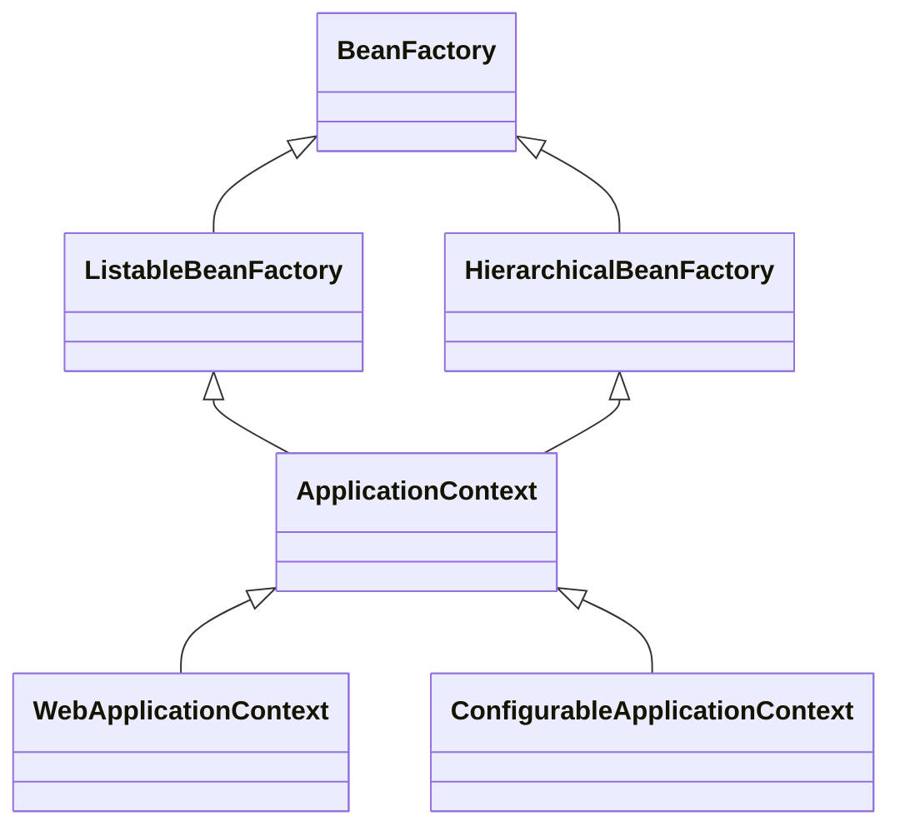
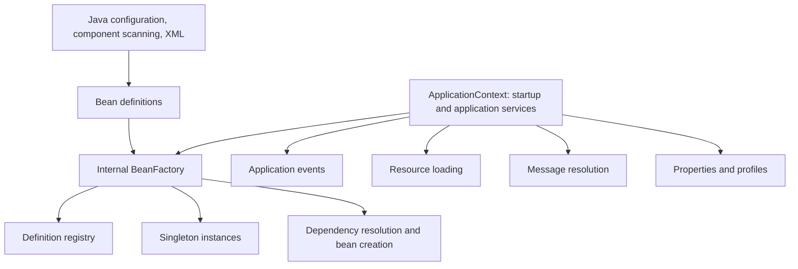
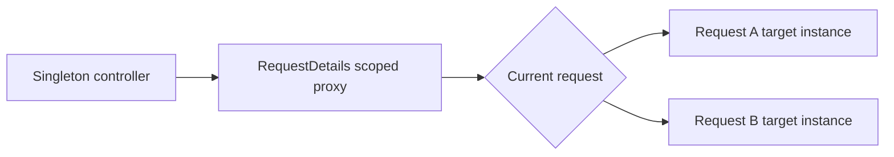
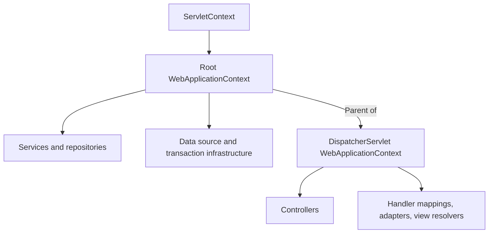
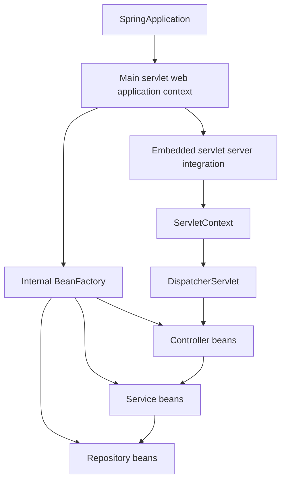
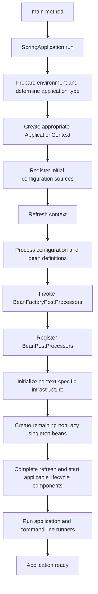
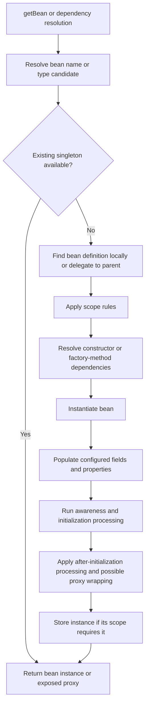
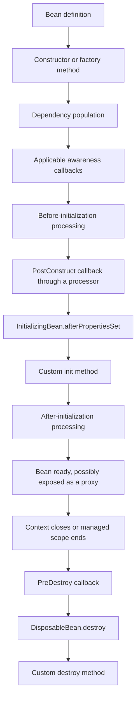

# Spring Container Notes: BeanFactory, ApplicationContext, and WebApplicationContext

These notes explain the responsibilities, architecture, lifecycle, and functional flows of Spring's containers. Diagrams use Mermaid; open this file in a Markdown viewer with Mermaid support to render them.

## Project walkthrough

This project demonstrates container inspection at startup. Its `pom.xml` targets
Java 17 and declares Spring Boot 4.1.1 with `spring-boot-starter-webmvc`.
`application.properties` sets the application name to `spring-boot-container`
and the server port to `9090`. There are currently no application controllers
or HTTP endpoints in the source tree.

### What the application does

1. `SpringApplication.run(SpringBootContainerApplication.class, args)` starts
   the application and returns its context. The MVC dependency enables servlet
   web application startup under the current configuration.
2. Component scanning discovers `EmployeeService` in the application's package.
   `@Service` gives it the default bean name `employeeService` and singleton scope.
3. Spring injects that service into the application bean's sole constructor.
   No explicit `@Autowired` is needed. The field stores this dependency, but
   the current demonstration does not read the field.
4. After startup returns, `main` prints `getBeanDefinitionCount()` and every
   name returned by `getBeanDefinitionNames()`. These describe registered
   definitions, not a count of instantiated objects. The list includes framework
   infrastructure and varies with dependencies and configuration.
5. `getBean("employeeService", EmployeeService.class)` retrieves the service
   using its name and required type. The local variable in `main` is separate
   from the injected field; both resolve the same singleton in this context.
6. `containsBean("employeeService")` reports availability, and
   `isSingleton("employeeService")` checks singleton scope. Availability alone
   does not prove that a bean has already been instantiated.
7. `getEnvironment().getProperty("server.port")` reads the configured port.
   With the checked-in properties it returns `9090`; command-line arguments
   or other property sources can override it. It does not report the actual
   bound port when a random port is requested with `server.port=0`.
8. `display()` prints `EmployeeService -> display()`. The web application
   remains running until stopped.

### Bean lookup alternatives

The commented examples in `main` show two alternatives to the active lookup:

| Expression | Meaning |
|---|---|
| `getBean(EmployeeService.class)` | Resolve by type |
| `(EmployeeService) getBean("employeeService")` | Resolve by name, then cast the result |
| `getBean("employeeService", EmployeeService.class)` | Resolve by name and require a compatible type |

Constructor injection is the normal way to supply service dependencies to
application components. Explicit lookups here illustrate the container API.

### Run and inspect

From the project directory in PowerShell, run:

```powershell
.\mvnw.cmd spring-boot:run
```

After the Spring Boot startup logs and bean-name listing, the current code prints
these diagnostic lines (the spelling matches the source):

```text
Bean is avialable :true
Server Port :9090
is this singleton class :true
EmployeeService -> display()
```

The bean count is deliberately omitted here because it depends on configuration.
Stop the application with `Ctrl+C`.

The existing `SpringBootContainerApplicationTests.contextLoads()` test checks
that the Spring test context can start. It does not explicitly invoke `main`
or assert the diagnostic output. Run it with `.\mvnw.cmd test`.
Generate source API documentation with `.\mvnw.cmd javadoc:javadoc`;
the Maven output reports the generated documentation location under `target`.

The remaining sections explain the broader container concepts illustrated by
this demonstration; their sample classes are not additional project components.

## 1. Core concepts

### Inversion of Control (IoC)

IoC means that a framework controls object creation and wiring instead of application code doing it manually.

Without a container:

```java
UserRepository repository = new UserRepository();
UserService service = new UserService(repository);
```

With Spring, classes declare dependencies and the container supplies them:

```java
@Repository
public class UserRepository {
}

@Service
public class UserService {
    private final UserRepository repository;

    public UserService(UserRepository repository) {
        this.repository = repository;
    }
}
```

These public classes belong in separate files. Spring must discover them through component scanning or explicit registration.

### Dependency injection (DI)

DI is the process of providing an object's dependencies from outside the object. Constructor injection makes required dependencies explicit and supports simple unit tests.

### Bean and bean definition

- **Bean:** An object managed by Spring.
- **Bean definition:** Metadata describing how to create and configure a bean, including its class or factory method, scope, dependencies, and lifecycle settings.
- **Container:** The infrastructure that interprets definitions, creates beans, and manages them.

Registering a bean definition and creating a bean instance are separate operations.

## 2. Container architecture

### Interface hierarchy



This diagram shows the relevant inheritance paths, not every interface. `ApplicationContext` also provides contracts for events, messages, resource loading, and environment access.

| Interface | Main responsibility |
|---|---|
| `BeanFactory` | Access beans and inspect basic bean metadata |
| `ListableBeanFactory` | Enumerate and discover beans in the factory |
| `HierarchicalBeanFactory` | Support a parent bean factory |
| `ApplicationContext` | Combine bean management with application services |
| `ConfigurableApplicationContext` | Expose configuration and lifecycle operations such as refresh and close |
| `WebApplicationContext` | Integrate an application context with the Servlet environment |

### Internal composition



Many application contexts delegate bean management to an internal `DefaultListableBeanFactory`. An application context therefore extends the container's public capabilities while coordinating additional infrastructure around a bean factory.

## 3. BeanFactory in detail

`org.springframework.beans.factory.BeanFactory` is the foundational bean-access interface.

### Common operations

```java
PaymentService service = factory.getBean(PaymentService.class);
Object bean = factory.getBean("paymentService");
boolean exists = factory.containsBean("paymentService");
boolean singleton = factory.isSingleton("paymentService");
Class<?> type = factory.getType("paymentService");
```

Lookup by type requires a resolvable candidate. Multiple candidates can require qualification or a primary candidate. Missing beans and unresolved ambiguity can cause lookup failures.

### Example: a bare bean factory

```java
import org.springframework.beans.factory.support.DefaultListableBeanFactory;
import org.springframework.beans.factory.support.RootBeanDefinition;

public class BeanFactoryDemo {
    public static void main(String[] args) {
        DefaultListableBeanFactory factory = new DefaultListableBeanFactory();
        factory.registerBeanDefinition(
                "paymentService",
                new RootBeanDefinition(PaymentService.class));

        PaymentService first = factory.getBean(PaymentService.class);
        PaymentService second = factory.getBean(PaymentService.class);
        System.out.println(first == second); // true: default singleton scope

        factory.destroySingletons();
    }

    public static class PaymentService {
        public PaymentService() {
            System.out.println("PaymentService created");
        }
    }
}
```

The factory normally creates this bean when it is first requested. It reuses the instance for subsequent singleton lookups.

### Lazy creation is not an absolute rule

A bare factory does not automatically run an application context's refresh process. However, a `DefaultListableBeanFactory` can explicitly create eligible non-lazy singletons:

```java
factory.preInstantiateSingletons();
```

Therefore, “BeanFactory is always lazy” is an oversimplification.

### Annotation infrastructure

A bare factory does not automatically activate component scanning or every annotation processor. Features such as `@Autowired` and `@PostConstruct` depend on registered infrastructure. Manually registering a class is not equivalent to starting an annotation-based application context.

BeanFactory supports dependency injection, scopes, and bean processing through its implementations and configuration. The difference is how much infrastructure the caller must assemble.

### Typical uses

- Container internals and framework integration.
- Programmatic bean definition registration.
- Custom infrastructure requiring direct control over bean creation.

For normal application development, prefer an application context.

## 4. ApplicationContext in detail

`org.springframework.context.ApplicationContext` provides bean factory capabilities plus application-level services.

### Example: Java configuration

```java
import org.springframework.context.annotation.AnnotationConfigApplicationContext;
import org.springframework.context.annotation.Bean;
import org.springframework.context.annotation.Configuration;

public class ContextDemo {
    @Configuration
    static class AppConfig {
        @Bean
        PaymentService paymentService() {
            return new PaymentService();
        }
    }

    static class PaymentService {
        public void pay() {
            System.out.println("Payment processed");
        }
    }

    public static void main(String[] args) {
        try (AnnotationConfigApplicationContext context =
                     new AnnotationConfigApplicationContext(AppConfig.class)) {
            context.getBean(PaymentService.class).pay();
        }
    }
}
```

The constructor used here registers configuration and refreshes the context. Closing the context triggers applicable destruction callbacks.

### Additional capabilities

| Capability | Explanation |
|---|---|
| Startup coordination | Prepares infrastructure and initializes eligible singleton beans |
| Post-processor discovery | Invokes declared factory post-processors and registers bean post-processors |
| Events | Publishes events to registered listeners |
| Internationalization | Resolves locale-specific messages through `MessageSource` |
| Resources | Accesses classpath, filesystem, and URL resources |
| Environment | Exposes properties and active profiles |
| Hierarchy | Allows child contexts to resolve beans from a parent |

### Initialization defaults

During refresh, a context normally pre-instantiates non-lazy singleton beans. This helps detect dependency and configuration errors during startup.

It does not create every possible bean at startup: lazy singletons, prototypes, and web-scoped beans follow different rules.

```java
@Bean
@Lazy
PaymentService paymentService() {
    return new PaymentService();
}
```

A lazy bean can still be created during startup if an eager singleton directly requires it. `@Lazy` on an injection point can supply a proxy that defers dependency resolution.

### Events

```java
public record OrderCreatedEvent(Long orderId) {}

// Inside a Spring-managed component with an injected publisher:
publisher.publishEvent(new OrderCreatedEvent(101L));

// Inside a Spring-managed listener:
@EventListener
public void handle(OrderCreatedEvent event) {
    System.out.println(event.orderId());
}
```

Ordinary application event delivery is synchronous by default. Asynchronous handling requires additional configuration.

### Resources, messages, and environment

```java
Resource resource = context.getResource("classpath:application.properties");
String name = context.getEnvironment().getProperty("spring.application.name");

// Requires a configured message source containing this message code:
String welcome = context.getMessage("welcome.message", null, Locale.ENGLISH);
```

Profiles conditionally activate bean definitions:

```java
@Configuration
@Profile("dev")
class DevelopmentConfig {
}
```

### Common implementations

| Implementation | Configuration style |
|---|---|
| `AnnotationConfigApplicationContext` | Java configuration and annotated classes |
| `ClassPathXmlApplicationContext` | XML resources on the classpath |
| `FileSystemXmlApplicationContext` | XML resources at filesystem locations |
| `GenericApplicationContext` | Programmatic registration and flexible configuration |

## 5. WebApplicationContext in detail

`org.springframework.web.context.WebApplicationContext` extends `ApplicationContext` for Servlet-based applications.

It exposes the associated `ServletContext`:

```java
ServletContext servletContext = webApplicationContext.getServletContext();
```

A configured web context integrates Spring beans with servlet infrastructure and web scopes.

### WebApplicationContext versus ServletContext

| WebApplicationContext | ServletContext |
|---|---|
| Spring container interface | Servlet API interface |
| Manages Spring beans and dependencies | Represents the servlet web application |
| Provides Spring application services | Provides attributes, initialization parameters, and servlet resources |
| Connected to the servlet environment | Managed by the servlet container |

They are associated objects, not interchangeable names for the same object.

### Web scopes

| Scope | Lifetime |
|---|---|
| `singleton` | One instance per bean definition per Spring container |
| `prototype` | A new instance for each container request for that bean |
| `request` | One target instance per HTTP request |
| `session` | One target instance per HTTP session |
| `application` | One instance associated with the ServletContext |

The `websocket` scope is also available with the appropriate WebSocket infrastructure. It is not enabled solely because a web context exists.

### Request scope and proxies

```java
@Component
@RequestScope
public class RequestDetails {
    private final String id = UUID.randomUUID().toString();

    public String getId() {
        return id;
    }
}
```

`@RequestScope` creates a scoped proxy by default. A singleton service or controller can hold that proxy; each method call resolves the target associated with the current request.



Access outside an active request can fail. The context itself is not recreated for each HTTP request.

### Session and application scope

```java
@Component
@SessionScope
public class ShoppingCart {
    // State belonging to one HTTP session.
}

@Component
@ApplicationScope
public class ApplicationStatistics {
    // State associated with the ServletContext.
}
```

Session scope does not guarantee thread safety: concurrent requests can use the same session. Application scope differs from singleton scope when multiple Spring contexts share one ServletContext.

### Servlet versus reactive applications

`WebApplicationContext` is servlet-specific. Reactive Spring WebFlux applications have separate context infrastructure; do not assume every web application uses a servlet web context.

## 6. Web application architecture

### Traditional Spring MVC context hierarchy



The root context is often initialized by `ContextLoaderListener`. A `DispatcherServlet` can have a child context containing MVC-specific beans.

Visibility rules:

1. A child can resolve beans from its parent.
2. A parent cannot automatically see child-only beans.
3. Sibling contexts do not automatically see each other's beans.
4. A local bean name can hide the same bean name from the parent during child lookup.

This hierarchy is optional. A single context can be sufficient.

### Typical Spring Boot servlet architecture



A typical Boot servlet application has one main context containing both application and MVC beans. `DispatcherServlet` can use that existing context; two separate contexts are not mandatory.

This project's `pom.xml` declares `spring-boot-starter-webmvc`, so the servlet MVC architecture is the relevant model. The diagram illustrates a typical application; this repository currently has an `EmployeeService` but no application controllers or repositories.

## 7. Functional flow: application startup



This is a conceptual flow. Configuration processing participates in the factory post-processor phase. Embedded servlet server creation and startup occur through context-specific refresh and lifecycle hooks; they are not simply a separate step after all startup work.

`SpringApplication.run(...)` returns a `ConfigurableApplicationContext`:

```java
ConfigurableApplicationContext context =
        SpringApplication.run(DemoApplication.class, args);
```

Spring Boot automates container configuration; it does not replace the Spring container.

## 8. Functional flow: bean lookup and dependency injection



This is a simplified ordinary-bean path. `FactoryBean`, circular-reference handling, and specialized post-processors introduce additional branches.

Example dependency graph:

```text
OrderController requires OrderService
OrderService requires OrderRepository

Spring resolves and creates OrderRepository as needed,
supplies it to OrderService,
then supplies OrderService to OrderController.
```

Constructor cycles such as `A → B → A` cannot be resolved through ordinary constructor injection. Redesign the dependency relationship rather than relying on creation order.

## 9. Functional flow: bean lifecycle



The diagram summarizes typical callback ordering when distinct callbacks are configured. `@PostConstruct` is performed by a bean post-processor, not an independent phase outside all processors. Some awareness callbacks are also processor-driven.

```java
import jakarta.annotation.PostConstruct;
import jakarta.annotation.PreDestroy;
import org.springframework.stereotype.Component;

@Component
public class ReportService {
    @PostConstruct
    public void initialize() {
        System.out.println("Prepare resources");
    }

    @PreDestroy
    public void cleanup() {
        System.out.println("Release resources");
    }
}
```

Important lifecycle boundaries:

- Managed singleton destruction normally happens on graceful context shutdown.
- Spring initializes prototypes but does not automatically destroy them after handing them to callers.
- Request and session scopes have their own destruction boundaries.
- A process crash or forced termination does not guarantee cleanup callbacks.

## 10. Container extension points

### BeanFactoryPostProcessor

Operates on bean definition metadata before ordinary singleton initialization. It is suitable for changing configuration metadata, not for normal business logic.

### BeanDefinitionRegistryPostProcessor

A specialized factory post-processor that can add further bean definitions. Configuration-class processing uses this extension mechanism.

### BeanPostProcessor

Participates in processing bean instances. Specialized implementations support injection, initialization annotations, and proxy creation.

```text
Bean definitions → factory post-processing → instance creation → bean post-processing
```

An application context discovers declared processors and coordinates their execution or registration. A bare bean factory needs explicit setup.

## 11. Interview revision

**What is BeanFactory?**  
The foundational Spring bean-access contract, backed by implementations that create beans and resolve their dependencies.

**What does ApplicationContext add?**  
Application services such as events, message resolution, resources, environment access, and coordinated container initialization.

**What does WebApplicationContext add?**  
Servlet integration, ServletContext access, and support for web-scoped bean infrastructure.

**Must a web application have parent and child contexts?**  
No. Traditional MVC applications often use them, while typical Spring Boot servlet applications use one main context.

**Which should application code normally use?**  
Use constructor injection for dependencies. Let Spring Boot or the application bootstrap choose and configure the appropriate context.

**How do the three relate?**  
BeanFactory provides the foundation; ApplicationContext adds application services; WebApplicationContext specializes that application container for the Servlet environment.
